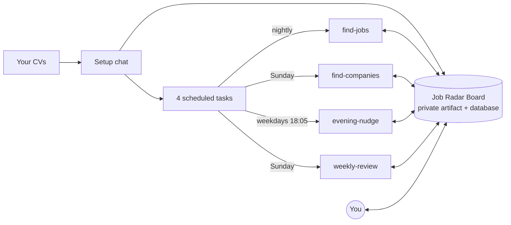

# Job Radar

**A personal job-search radar that runs on Claude.** Every night it searches company careers pages and job boards for roles that fit your CV, scores each one honestly, and puts the best ones on a private dashboard. You open it in the morning and apply.

No servers, no API keys, no code to run. It lives in your claude.ai account.

---

## Start in one message

Open [claude.ai](https://claude.ai), start a new chat, and send:

```
Set up Job Radar for me: https://github.com/EttoreTheWebisteMaster/job-radar
```

Claude reads this repo, asks for your CV, asks a few questions about what and where you're looking, shows you a plan, and builds everything after you say go. About 10 minutes.

**You need:** a paid claude.ai plan with artifacts and scheduled tasks. **Recommended:** the [Tavily](https://tavily.com) connector, which makes reading careers pages much more reliable.

---

## What you get

| | |
|---|---|
| **The Board** | A private dashboard on claude.ai. *Today* shows the one role to apply to next, your daily goal and streak. *Roles*, *Companies* and *Sources* hold everything the radar found. Paste any job link to score it on the spot. |
| **Nightly search** | Checks your companies' careers pages and the open web, verifies every posting is live, scores it against each of your CVs, and saves the ones worth your time. |
| **Weekly company hunt** | Rebuilds your profile from your CVs and finds new companies near you that hire people like you. |
| **Evening nudge** | On weekdays, if you haven't applied to anything yet, one push notification with the best waiting role. |
| **Sunday review** | What you did this week, what's working, what to change. The radar also learns which roles you actually apply to and get replies from. |

## How it scores

Every posting gets a 0-100 fit per CV. Requirements are tagged *core*, *listed*, *nice* or *inferred*, and hard caps stop wishful matches: a missing core requirement caps the score at 55, years asked in a technology you only used in side projects cap it at 70, and so on. It only claims what your CV shows. [Full rules →](skills/job-radar/references/rulebook.md)

| fit | verdict |
|---|---|
| 80+ | apply now |
| 70-79 | apply with the right CV |
| 60-69 | stretch |
| below 60 | not shown |

## How it works



- **One skill, five modes.** `skills/job-radar/` holds the rules and one step list per mode. Scheduled tasks call it with the Board's URL.
- **The Board is the only state.** Your CV text, settings, roles, companies and what the radar learned live in the Board's database. Nothing is stored anywhere else.
- **You stay in control.** Anything you edit on the Board is never overwritten. Anything you delete never comes back. The radar never applies or sends messages for you.

## Privacy

Your CV and job data stay in your own claude.ai account, on an artifact that is private until you share it. Searches never include your name or contact details. This repo contains no personal data.

## Update

When a new release is out, tell Claude: `Update my Job Radar to the latest release`. Your data stays; the page and the scheduled tasks are refreshed.

## Install the skill (optional)

Setup works straight from the repo link. Installing the skill makes scheduled runs faster and lets you pin the version you trust.

- **claude.ai:** download `job-radar-skill.zip` from the [latest release](../../releases/latest) and upload it in Settings → Capabilities → Skills.
- **Claude Code:** `/plugin marketplace add EttoreTheWebisteMaster/job-radar`, then `/plugin install job-radar@job-radar`.

## Repository

```
skills/job-radar/
  SKILL.md                 entry point: picks the mode
  references/
    setup.md               the setup protocol Claude follows
    rulebook.md            every rule: location, tiers, scoring, learning
    schema.md              the Board's data model
    find-jobs.md  find-companies.md  weekly-review.md  evening-nudge.md  update.md
  assets/
    board.html             the dashboard
    capabilities.json      what the dashboard is allowed to use
    schedules.md           scheduled task prompts and times
    seed/                  starting sources and an example settings file
    release.json           version and repository
.claude-plugin/            Claude Code plugin manifest
```

## Limits

- Built for job seekers based in Europe. Elsewhere it works, but relocation and remote-scope rules assume European geography.
- It reads public pages. Sites that need a login (LinkedIn job details, some boards) are used for discovery only.
- Coverage is never complete. Treat it as a radar, not a guarantee.

---

<details>
<summary><b>For Claude: how to set this up</b></summary>

You were given this repository to set up Job Radar for the user. Do this:

1. Clone it: `git clone --depth 1 https://github.com/EttoreTheWebisteMaster/job-radar.git` (if you cannot clone, read the files below through their raw GitHub URLs).
2. Read `skills/job-radar/SKILL.md`, then follow `skills/job-radar/references/setup.md` phase by phase. It tells you what to ask, when to ask, and what to build.
3. Start by asking for the user's CV. Do not create anything before the user approves the plan in Phase 3.

</details>

## License

MIT © Ettore Serra — built with Claude. Issues and pull requests welcome.
